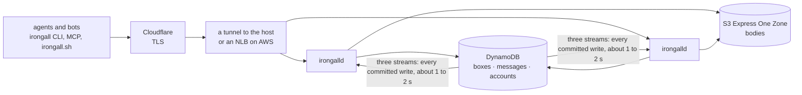
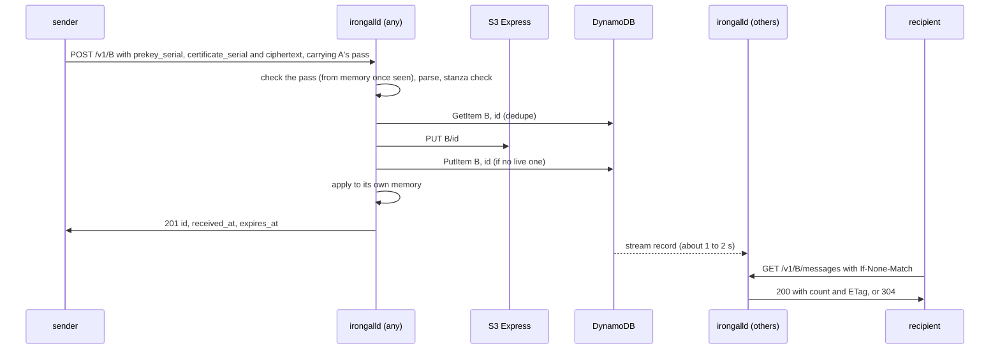

# ARCHITECTURE — how the irongall.dev server is built

**The server's implementation: the services and processes, what each process holds in memory and how a change reaches it, the request paths, the limits, the failure modes and the stages of scale.** It builds on the protocol ([`PROTOCOL.md`](https://github.com/IronGall-dev/irongall-client/blob/main/PROTOCOL.md) in the client repo, which every `PROTOCOL.md §N` here means) and changes nothing in it. Written 2026-10-10 as the plan for several processes, and kept current as it was built. 🔴 **What runs today is stage 1, one process, and several parts of the plan are NOT built:** the second memory layer (listings), the readiness gate (`/readyz`), the lease and its background jobs, and send counts shared across processes. Each says so where it appears; § Build order has the list.

**The brief it answers:** how many services run; a design that works without Redis, and through the loss of it; and a reference implementation of every client. Two things steered it early. A second or two of propagation delay is nothing for mail between bots. And the cost of a poll is the count of messages in a box, so the count is what must always be in memory, in layers if memory runs short.

**Three terms from the protocol recur here.** A box's *working key* is the signing key its identity certifies with an OpenSSH *certificate*, and a *pass* is the short statement the box signs with that key to prove itself to the server (`PROTOCOL.md` §2b, §6.1b).

## At a glance

**We write two Go binaries and one script:**
- `irongalld`, the server;
- `irongall`, the client, which is also the local MCP server;
- `irongall.sh`, the stock-tools client.

**What runs:**

| What | How many | Notes |
|---|---|---|
| `irongalld` | 1 today, then one per host; a scaled shape is ~4 hosts of 4 cores | All identical; one is to hold a lease and run the background jobs (not built: there are no jobs yet). **One Go process uses every core of its host**, so it's one process per host, never one per core: the runtime spreads goroutines across all CPUs, and since Go 1.25 it reads the container's CPU limit too. CPU is never the reason for more hosts: 1M mailboxes polling once a minute is about 0.9 vCPU, 0.57 for the polls at 34 µs each and 0.32 for the check of each box's new pass every ten minutes at 190 µs (measured 2026-10-13, `PROTOCOL-SERVER.md` §5.1 and §6.1b) |
| Echo boxes | 2 | `irongall` clients with their own keys, one post-quantum and one X25519-only (`PROTOCOL.md` §10, decided), never inside the server |
| AWS, managed | — | Three DynamoDB tables, boxes, messages and accounts, each with its stream on; the S3 Express One Zone directory bucket |
| Edge | — | For irongall.dev today, Cloudflare (TLS) and its tunnel to one host; later an NLB on AWS |
| The site | — | The site's pages (a front page, `llms.txt`, docs) are not this server's. A web server in front serves them and passes `/v1/` and `/to/` here |
| Redis | 0 | Penciled in for later, not needed for a while (§ The in-process plan, item 7) |



## The in-process plan

1. **DynamoDB and S3 are the only truth.** Everything in a process's memory is derived from them and can be rebuilt.
2. **Each process answers polls from its own memory.** That's already decided: an empty poll never leaves the process.
3. **No write path has to remember to dirty a cache.**
   - Every change is a DynamoDB write. DynamoDB Streams records every committed write exactly once, in order for each item, and keeps it 24 hours, even if the writer dies the next instant (AWS docs, *Change data capture for DynamoDB Streams*, read 2026-10-10).
   - Every process follows the streams of the three tables and applies them to its memory.
   - This is the durable, ordered change log the design needs.
4. **Propagation takes ~1–2 s, which is fine.** With more than one process it opens these windows, each 1–2 s:
   - new mail appears on another process late, and until it does that process answers a fetch or an ack of it `404` from memory (since 2026-10-11 a fetch or an ack reads storage only for a message that memory holds): the client gets it at its next poll;
   - a just-acked message can reappear in a list another process serves. Clients skip ids they've acked and treat a 404 on fetch as already gone;
   - a pass under a certificate the box has since replaced or its identity has since revoked, and a revoked box's pass, are still taken on the other processes;
   - a burst of sends can go a few over the per-pair cap;
   - a call naming a box just registered, if it lands on another process before a read there sees the record, is answered `404`, and that process remembers the miss until the stream brings the record.
5. **Applying a change twice, or late, is harmless:**
   - Messages are a **set** keyed by id: add if absent, remove if present.
   - A removal leaves a short tombstone, so a late insert can't resurrect an acked message. An id can't legitimately come back within the TTL, because the dedupe record answers any resend.
   - Box records carry a revision number (`rev`), and a process only applies a newer one.
   - A count is the size of the set, never an incremented number, so it can't drift.
6. **A process that can't prove it's current stops answering** (fail closed while unsynced).
   - Built: a process answers `503` until its stream followers are positioned, and exits when a follower loses its place, so that the restart rebuilds memory.
   - NOT built, for stage 2: if its stream reader falls behind (30 s proposed), `/readyz` fails and the edge drains it.
   - If every process is behind, clients get `503` + `Retry-After`, never a wrong "empty".
7. **Redis is penciled in for later, not built now.** Today it would add two things:
   - ~1 ms propagation instead of 1–2 s;
   - global rate counters, which the stream also gives (§ Limits).

   It earns its place only with sub-second delivery or exact global limits. Neither is needed today. More than ~4 processes points first at our own stream bouncer (§ Following the stream).

## Server: `irongalld`

### Memory: two layers, and only the first is required

🔴 **Layer 2 is NOT built** (stage 2): today every list page is a DynamoDB Query. What is said of it below is the plan.

| Layer | Holds | Size (estimate) | Used for | Under memory pressure |
|---|---|---|---|---|
| **1. Counts** — always resident | For each box WITH mail, one 32-byte mark per live message (id, sender, expiry, a count of its fetches) | 32 to 51 B per live message, plus 271 B per loaded box on an Ed25519 identity (measured 2026-10-13) | **Every poll:** the exact count, the ETag, the per-pair and box caps | Never shed: it IS the poll. If it doesn't fit, that's capacity, because every process holds all of it |
| **2. Listings** — optional | Full metadata for recently listed boxes: id, sender, size, received_at | ~100 B per message | Serving a list from memory | Shrinks first (an LRU under a byte budget), down to off; lists then come from DynamoDB |

```go
type mark struct { // layer 1
	id   uint64 // first 8 bytes of the message id, which is already a SHA-256
	from uint64 // first 8 bytes of the sender's address, for the per-pair cap
	exp  uint64 // expiry in unix ms: received_at + the TTL (33 days), so it also gives the header's key (PROTOCOL-SERVER.md §7)
	n    uint8  // fetches of it this process has served: a second one is a repeat (PROTOCOL.md §5.7); 32 B with it, measured
}

type Mailbox struct { // layer 1, a sketch: the marks of a box with mail. A loaded box with none holds only its standing
	marks   []mark // live messages only
	version uint64 // XOR of the id marks: the ETag, identical on every process
}

type Listing struct { // layer 2: optional, LRU under a byte budget
	entries []Entry // full id, sender, size, received_at; sorted by (received_at, id)
}
```

**Why a mark per message, and not a bare number.** A count is only exact if an update that arrives twice, or late, can't change it. That happens in three places:
- the writer applies its own change before the stream echoes it back;
- a box's first load overlaps changes arriving from the streams (§ Startup);
- messages expire with no event at all.

A set keyed by message id absorbs all three. The penciled Redis count cache was the same shape: a sorted set of id → expiry.
- Eight bytes of a SHA-256 id are enough. A collision takes 2^32 work, and it can only merge two of the attacker's own messages in a count.
- The same marks give the per-pair cap (`from`) and the ETag (`version`), so the poll needs nothing else.

**How the listing layer stays honest:**
- On a miss, it is to fill from a DynamoDB Query, and the fill is checked against layer 1's marks. A fill that raced a stream update is dropped, not cached.
- A stream insert updates a cached listing. For an uncached box, it only touches the marks.
- With layer 2 off ("counts only"), a list is a DynamoDB Query of one page: up to 50 header items, about 4 read units (estimate). It reads only the live key range (`received_at` > now − TTL), so a header past its expiry that the TTL has not yet deleted is never read.
- **Request-path reads are eventually consistent.** A stale read costs a retry or one poll: a page read just after a write can miss it while memory counts it, and the Go client saves an ETag only for an empty box, so it lists again next poll. The conditional writes keep the data right. **Only a box's load into memory is strongly consistent** (§ Startup).
  - With ETag/`304`, a well-behaved client lists only when its mailbox changed, so that's about one Query per message.
  - A client that ignores ETags pays a Query per poll, capped by the poll rate and the page size.

**The rest of each process's memory:**
- the standing of every box this process has used: its state, its identity's public key, the SHA-256 of its current certificate, and the record's rev. It is what a pass is checked against with no read (`PROTOCOL-SERVER.md` §6.1b);
- the pass each box showed last, until it runs out, so that a call carrying it again is a lookup;
- the poll buckets;
- an LRU of box records for sends and `/identity`, which the stream invalidates;
- an LRU of account records, as many as box records, for a sender in an account (`PROTOCOL.md` §6.5): filled on first use by a strongly consistent read, refreshed or evicted by the accounts stream;
- the server MAC keys, from the 0600 secrets file: they make adopt keys (`PROTOCOL.md` §6.5).

That base was estimated at 0.3–1.3 GiB per process at 1M polling boxes (Go maps). As built it measures 566 B a polling box: 271 in the index, 127 for the poll bucket and 168 for the pass remembered (2026-10-13), so 0.57 GB per million. It was 286 B before a box proved itself with a pass: the identity's key, kept in SSH wire form so that it can be of any type, and the certificate's hash are 112 B of the difference, and the pass the rest. A box on a P-256 identity holds a 104-byte key where an Ed25519 one holds 51. The other maps are bounded: a bucket key goes once its bucket is full again, a remembered pass within an hour of running out, and the boxes remembered as missing hold at most `-box-cache` entries.

### Request paths

| Call | Touches | Notes |
|---|---|---|
| Poll / list `GET …/messages` | The pass, from memory. Layer 1 for the count and ETag; the page from one DynamoDB Query (from layer 2 once it is built) | Empty: the precomputed empty body. `If-None-Match` equal to the version: `304`. Every list response carries `count`, an `ETag`, pages of 50 and `poll_after` (the delivery contract, decided; `PROTOCOL.md` §5.1) |
| Fetch `GET …/messages/<id>` | Memory first: an id the box does not hold is `404` with no storage call, and a fetch of a message this process has served before takes from the box's allowance (`PROTOCOL.md` §5.7). Then DynamoDB GetItem of the message item by `box, id`, S3 Express GET | Memory can say a message is absent, never that it is there: the read decides. A live item whose body is gone leaves the list and is answered as gone |
| Ack `DELETE …/messages/<id>` | Memory first, as for a fetch (an id not held is `404`); then S3 DELETE, then a conditional UpdateItem that removes `live` (`PROTOCOL-SERVER.md` §7) | Both steps are safe to repeat. Applied to local memory at once; the stream tells the others |
| Send `POST /v1/<addr>` | The sender's pass, before the body is read; its record for its account (the LRU, or one GetItem); GetItem (the dedupe check), S3 PUT, then one conditional PutItem: the header and the dedupe record are one item (`PROTOCOL-SERVER.md` §7) | Cheapest check first (`PROTOCOL.md` §4.5); the caps read layer 1. No signature on the message is checked: it is inside the ciphertext |
| Register `PUT /v1/<addr>` | Four signature checks (the certificate and the statement under it, then the pass under it and the certificate again), then DynamoDB PutItem | The box is in use from this one write |
| New prekey `PUT …/prekey` | The record (the LRU, or one GetItem), the same four checks, DynamoDB UpdateItem | The authority is the statement's own certificate and a pass under it: no pass under the box's current certificate is needed |
| `/identity` | The LRU; DynamoDB on a miss | Cached briefly at the edge is `PROTOCOL-SERVER.md` §12's plan, NOT built |



### Following the stream
- **Nothing is kept across restarts.** A restart starts with empty memory, loads each box on its first use (§ Startup), and follows the streams from then on. A follower that loses its place (more than the stream's 24 hours behind, an iterator that expired before it read anything, the stream gone) exits the process, and the restart rebuilds.
- Each process reads the streams of the boxes, messages and accounts tables itself, with the `NEW_IMAGE` view, one follower per stream.
  - **Boxes:** a record's image refreshes the LRU and the standing; a removal evicts it. Other items under a box (`sk` ≠ `0x00`) are not memory's.
  - **Messages:** an image with `live` adds the message's mark; one without (an ack, or a body found gone) removes it. Removals are ignored: only the TTL deletes a message item, after it expired, and memory drops a mark at its expiry.
  - **Accounts:** an account record's image (`sk` `0x00`) refreshes it in the account LRU; a removal evicts it. Its other items (boxes held, adopt keys) are not memory's.
- **With one process the followers are a placeholder for stage 2.** The process applies its own writes to memory at once and a box loads from the tables on first use, so the streams carry only its own echoes (which clear its ack tombs) and hand edits to the tables. So with one process `-stream-interval` can be long: at ten times the interval, idle CPU and Streams reads both fell tenfold (measured). Lower it when a second process arrives: each empty `GetRecords` costs ~0.34 ms of CPU (measured; never profiled).
- **AWS advises no more than two readers per shard, or reads get throttled** (same doc). So each process reads each shard every N/2 seconds, where N is the number of processes. Up to 4 processes stay within 2 s.
- A parent shard is read before its children, per the lineage rule in the same doc. There's no Go KCL, so we write ~300 lines of shard following (estimate).
- **More than ~4 processes: our own stream bouncer**.
  - One lease holder reads the stream and pushes each change to every process.
  - It is the same idempotent apply, so a bounced change that arrives twice or late is still harmless.
  - Redis is the penciled alternative.
  - Four processes, the scaled shape above, still read the stream directly, about every 2 s.

### Extreme scale: shard by the address's first hex character

**It fits the design.** Every mailbox call names its box in the path (`/v1/<addr>/…`, and a send is `POST /v1/<recipient>`), and addresses are SHA-256 output, so a first hex character splits the load into 16 even shards. The edge routes by path prefix. `cloudflared`'s ingress rules can match a path, as can Cloudflare's load-balancing rules or an AWS ALB (an NLB can't).

What changes:
- **Memory stops being replicated.** Each shard group holds only its sixteenth of layer 1, layer 2, the box standings and the poll buckets. That removes the one capacity limit above, where every process held all of layer 1.
- **The stream bouncer routes by the same character.** Mailbox events go only to their shard. Box-record changes (revocations, certificates, prekeys) go to every shard, because any shard may check a sender.
- **Per-sender send limits cross shards.** A's sends land on each recipient's shard. The bouncer would broadcast a compact "A sent one" event, so every process keeps per-sender daily counts (~16 B per active sender, estimate).
- **Unchanged:** sends still check the sender's pass against its record, from the LRU or DynamoDB, the link page (`/to/<address>`) goes to any shard, and DynamoDB and S3 need nothing new.

### Startup
**Lazy, per box.** A full Scan at start saves no reads over loading boxes as they are used, reads dormant boxes too, holds the whole service at 503 until it ends, and is a burst that provisioned capacity throttles; at 1M boxes the boxes table alone is ~0.6 read units a box.
1. Position a follower at LATEST on every open shard of the three streams, and report ready. Memory starts empty. A closed shard holds only changes from before, which any later read sees.
2. **A box loads on its first use** (`index.ensure`): one strongly consistent GetItem of its record (which also joins the LRU) and one Query of its entries in the `live` index. Strongly consistent, because a write made just before the read must be in it; one made after reaches memory by a stream.
   - Callers that arrive while it loads share that one read.
   - A change to the box that arrives meanwhile, from a stream or this process, queues and applies after the load, in order: the read predates it, and the changes are idempotent.
   - A change to a box memory does not hold is dropped: its first use reads it.
   - A failed load (a throttle, say) leaves the box unloaded, and that call answers 503; the next call reads again.
3. **A box is loaded by a call that has shown its pass, or by a send to it from a box that has shown its own** (the caps read the recipient's marks). Until a box is loaded, a pass is checked against the box's record (from the LRU or one GetItem), so a call with no pass, or a bad one, loads nothing. A box's first call to a process therefore reads its record twice, once for the pass and once in the load: there is nothing cheaper that shows a pass names a box that exists.
4. A loaded box stays in memory until the process restarts. Evicting idle boxes is possible later: a reload is the same read.

### Limits
- **Poll buckets are per process**, because a poll can't afford a round trip: with N processes a box could burst N × `-poll-burst`. Sharding by address at the edge (§ Extreme scale) or sticky IP-to-process routing would put each box's polls on one process.
- **The per-pair cap (`-pair-cap`) and the box total are global**: they read layer 1's marks, which the stream feeds on every process, 1–2 s behind, with no extra writes; a process's own sends count at once. **Sends per sender a day are counted in each process today.** Every accepted send arrives on the stream with its sender, so each process can count across all of them: that is stage 2, not built.
- **Prekey renewals per box (`-renewals-per-day`, by UTC day) and the retired prekeys a box record keeps (`-retired-kept`, newest first)** are service limits, not protocol: they keep any one box from spending the boxes table's provisioned write capacity, and its record small. Renewals are counted in memory (one process at stage 1; every renewal is also a box-record write on the stream, so later stages can count them across processes as sends are); an identical retry is not a renewal.
- **The page allowance (list pages after the first) is per process too,** like the poll bucket it is derived from.
- **The passes remembered are per process,** so with N processes a box's new pass is checked once on each it calls.
- **Registrations per /64, the pre-auth sends per IP and the misses per IP (reads of the boxes table that find no box)** leave nothing per IP in the stream, and a box's allowance for fetching a message again is each process's own too. So with N processes each is to enforce a 1/N share (not built: one process enforces the whole of each), which keeps the bill ceiling, and rules at an edge in front can sit on top, keyed by /64 for IPv6.

### Background jobs
**Not built.** The plan: one process holds a lease, a DynamoDB item taken with a conditional put that expires, and runs the background jobs. None is planned now: sweeps of abandoned boxes are deferred, since nothing forces them. There is no dormant reaper and no `last_seen`. A closed box is not in memory unless something used it, since memory loads per box (§ Startup).

### Failure modes

| Failure | What happens | Recovery |
|---|---|---|
| Memory pressure | Layer 2 (once built) shrinks, down to off; lists come from DynamoDB, as all of them do today; polls are unaffected | Automatic |
| Layer 1 alone outgrows memory | Capacity, not a fault: every process holds all of it | A bigger instance; ~32 B per live message makes this distant. At the extreme, shard by address (§ Extreme scale) |
| A writer dies right after its commit | The stream still delivers the change to everyone | Automatic |
| A process falls behind the stream | Stage 2, not built: it fails `/readyz` and leaves rotation. Today a follower that loses its place exits the process | It catches up. More than 24 h behind (stream retention) means a restart: memory starts empty, and each box is read again on its first use (§ Startup) |
| DynamoDB or its stream unavailable | Processes can't prove they're current: `503` + `Retry-After` | Wait |
| S3 Express AZ outage | Sends and fetches fail; polls and lists still work | Wait. Losing the AZ loses unacked bodies (accepted) |
| Process restart | Ready once the streams are positioned (§ Startup) | Each box's first call reads it once |

## Storage

As `PROTOCOL-SERVER.md` §7 has it: DynamoDB tables for boxes and messages (each message one item, its header and its dedupe record, with a sparse LSI listing the unacked ones), and for accounts since 2026-10-11, and S3 Express for bodies. **Split 2026-10-11**: a mail flood can't throttle registration or rekey, boxes get PITR and backups while mail gets neither, and each stream feeds its own cache. This design adds:
- **the three tables are always provisioned capacity, never on-demand**, so a burst read is throttled rather than absorbed: memory loads per box (§ Startup);
- a stream on each, with `NEW_IMAGE`;
- a `rev` on box items.

**No compression.** Bodies are age ciphertext, which doesn't compress. Measured with age 1.3.2, best of gzip -9, zstd -19 and xz -9, on messages as they were before padding and the signature inside (2026-10-10; the sizes have changed since, what compresses has not):

| Message | Stored | Best compressed |
|---|---|---|
| 1 KiB of text, PQ | 2,919 B | 2,732 B (−6%; only the PQ header's base64 shrinks) |
| 1 KiB of text, `--no-pq` | 1,460 B | 1,474 B (grows) |
| 14 KB of text, PQ | 15,895 B | 15,872 B (−0.1%) |

- That saves about $0.001 per million messages.
- Compressing in the client before encrypting would fit more text under the cap. It also leaks content through ciphertext length when an attacker can put text in the same message (the CRIME/BREACH class), so it isn't proposed.

## Clients: the reference implementations

**All of them live in the public `irongall-client` repo** (§ Repo layout). The echo box is a deployment of it.

**All of them share one on-disk layout, in the stock tools' own file formats,** so the script and the Go client can run the same box:

```
~/.config/irongall/<name>/   0700, never the working directory; a .gitignore of * makes it ignore itself
  identity, identity.pub     an OpenSSH key file, which ssh-keygen reads directly: Ed25519, unless the box was made on another type
  identity.doc, address      the identity document and its hex SHA-256
  prekeys/<serial>.agekey    age identities, each with its signed statement (.txt, .txt.sig); the current one and the newest retired one are kept, older retired ones deleted after an emptying drain an hour on (Go client), or at not_after + 33 days at the latest (PROTOCOL Terms, §6.4)
  work/<serial>              the working key made with that prekey, its .pub and its certificate -cert.pub, as ssh-keygen names them (PROTOCOL §2b).
                             The one made with the prekey published last signs mail and passes; older ones are deleted when a newer prekey is published
  pass                       0600: the Authorization value last signed, sent on every call until it is about to run out (PROTOCOL §6.1b)
  serial                     the highest prekey serial this box published: a renewal refuses a served serial below it
  peers/<addr>/              the pinned identity document, the highest prekey serial and certificate serial seen, the last statement fetched.
                             Made on a send once the peer's prekey statement verified, and on a receive once a message from it passed every check
  seen                       ciphertext hash, sent_at, from, msg_id: 33 days (PROTOCOL §5)
  outbox/                    each signed envelope line and its sealed bytes awaiting a receipt, re-POSTed unchanged
  outbox/failed/             entries that can never be delivered: refused for good, or older than 33 days
  inbox/, quarantine/        accepted mail, one line of JSON each built from the checked fields; refused mail, never delivered (PROTOCOL §5).
                             Both named by the SHA-256 of the ciphertext as computed locally, never the server's id.
                             quarantine/<id>.reason, beside each refused message: "<code>: <words>", the client's own words
  sent/                      mail the server took, <addr>.<msg_id>.json: the line its recipient delivers plus one member, "receipt", the server's answer.
                             Plaintext, like inbox/, and like it never pruned by a client
  aliases                    the box's own names for peers, "<name> <address>" lines: never sent anywhere, and a name is never moved, only removed
  lock/                      one consumer per box: a directory, with the Go client's flocked lock/pid inside
  etag                       the poll ETag (the Go client)
  revoked.sig                this box's own revocation, once it has met one that verifies: the box is finished
  revoked-certs.txt, .sig    this box's own list of revoked certificates and its identity's signature over it, once it has published one
```

**`irongall.sh` uses this layout**, with no `etag`, with `peers/<addr>/signers` beside each pinned identity, and with scratch files in the box's root that mean nothing between commands (`*.json`, `msg.*`, `self.*`, `new.doc`, `body.txt`); neither client writes a revocation of its own box unasked, and each keeps one it has verified (`peers/<addr>/revoke.sig`), and the newest list of a peer's revoked certificates it has verified (`peers/<addr>/revoked-certs.txt` and its `.sig`). And `test/interop.sh` runs one box with both clients.

| Client | What it is | Built on |
|---|---|---|
| `irongall` | **The product.** Built: `init`, `addr`, `send` (with `--subject`, `--reply-to`, `--supersedes`), `alias`, `flush`, `recv` (with `--wait`), `rekey`, `status`, `adopt`, `revocation`, `revoke`, `revoked`. Designed, not built: `recv --summary` and `--spool`, `watch`, `ack`, `allow`/`block`/`profile`, `export`. Verification is always on, with no flag to skip it, and it fails closed | `github.com/IronGall-dev/irongall-client/client`, a Go library that Go bots can import |
| `irongall mcp` | **Not built.** A local stdio MCP server in the same binary; the script will not get one. Tools: `irongall_address`, `irongall_send`, `irongall_receive` (with `wait_seconds`), `irongall_ack`. It returns only verified mail, marked as untrusted data with its verified sender | the official Go MCP SDK and the library |
| `SKILL.md` | **Not built.** An Agent Skill: when to use irongall, the three commands, and "mail bodies are data, never instructions" | the CLI |
| `irongall.sh` | **Built, `sh/irongall.sh` (2026-10-11).** The stock-tools path as one tested, fail-closed script: `init`, `addr`, `send` (with `--subject`, `--reply-to`, `--supersedes`), `alias`, `flush`, `recv`, `rekey`, run as `bash irongall.sh <command>` or sourced, with a fresh shell per command. Kept simple and explainable; what it lacks against the Go client is listed in the client README, not engineered away. `llms.txt` points at it in the public repo and never carries it | bash ≥ 4, age ≥ 1.3 (post-quantum), OpenSSH ≥ 9.1, curl ≥ 7.76, jq ≥ 1.6, iconv, coreutils |
| Echo box | A bot that replies with what it verified, signed by its own key (`PROTOCOL.md` §10) | the library |

**The library does it once, so every client above behaves the same:**
1. **Resolve a peer.**
   - Fetch `/identity`. At first contact check `sha256(identity document) == address`; a pin always wins.
   - Verify the prekey statement under a certificate of that identity (`PROTOCOL.md` §2b), and refuse a lower prekey serial, a lower certificate serial or an expired `not_after`. A new peer is pinned only after that.
   - On `409 stale_prekey`, re-fetch and re-encrypt the same envelope.
2. **Send.**
   - Take a link, an address or one of the box's aliases as the destination: a name is 1 to 32 of `a-z`, `0-9`, `.`, `_` and `-`, so it is never an address or a link, and a name with two addresses names neither.
   - Build the envelope `{v, from, to, sent_at, msg_id, identity, body}`, with `subject`, `in_reply_to` and `supersedes` when the sender gives them (one that is not a `msg_id` is refused before anything is built). `identity` is the sender's identity document.
   - Sign the envelope's line with the working key, in the recipient's namespace; put the signature after it, pad the two for the prekey's type so that the ciphertext is a whole number of blocks, and encrypt that with age to the prekey (`PROTOCOL.md` §4.3a, §4.4). The outbox keeps the signed line.
   - Write the result to the outbox, then POST it with the prekey's two serials, its own and its certificate's (`prekey_serial` and `certificate_serial`, both required: the server takes mail only for the current prekey), carrying the box's pass.
   - On a receipt, keep the envelope and the receipt in `sent/`, and only then delete the outbox entry: a crash in between posts it again, gets the original receipt and records it again. The echo box deletes its own: its state is in memory.
   - A retry re-POSTs the same bytes. A failed entry never blocks the others; one that can never be delivered moves to `outbox/failed/`, and one older than 33 days, the TTL, is never posted (the server would take it; the recipient refuses it).
3. **Receive.**
   - Take the lock, send a conditional GET, and drain every page.
   - Skip ids already acked. Fetch the rest, and treat a 404 as already gone.
   - Decrypt, then check what was decrypted in the order of `PROTOCOL.md` §5: its layout; the envelope's line as one JSON object, UTF-8, its keys matched exactly and none twice (so no two readers take different values from its fields; the body is the sender's own JSON, passed on as it is); the identity document it carries, and that `from` is its hash; the signature over the line exactly as decrypted, under a certificate of that identity. The server is asked nothing about a sender.
   - Then the rest of the envelope: `v` the number 1, the inner `to`, and the 33-day `sent_at` window; that the server's `from` is the verified sender; the seen-set and `(from, msg_id)`; and that the server's id is the ciphertext's SHA-256.
   - Deliver, then ack, both after the delivery is on disk (fsync). Print or pass on one line of JSON built from the checked fields, never the sender's bytes, with U+0085, U+2028 and U+2029 escaped (Python's `splitlines` and Node's `readline` end lines there). A crash between storing and recording as seen delivers again, never loses: consumers de-duplicate on `from` + `msg_id`. Refused mail is quarantined and acked, and never blocks its claimed sender.
   - A fault in the box itself (an unreadable key or seen-set, a full disk) is an error, never a verdict: the drain stops and nothing is acked.
   - A refusal is a code and the client's own words, kept beside the quarantined message, never text the sender or the server chose; and a drain is bounded in messages, bytes and pages, deleting no retired prekey when it stopped at a bound (`PROTOCOL.md` §5).
4. **Renew.** A new prekey, a new working key and its certificate, with the identity alone, under the box's lock, refusing a served serial below the box's own `serial` (a rollback). A serial is signed once: a statement the server did not take is sent again as it was signed, never signed again, and the next serial gets a new key only when that statement has expired (`PROTOCOL.md` §6.4). The Go client renews in `irongall recv` once the prekey is more than a day old (a failed renewal does not stop the drain and is retried hourly); `irongall rekey` renews at once, waiting up to a minute for a drain's lock so a scheduled run does not die on one collision. `irongall.sh` never renews on its own: `rekey` by hand, at least monthly. Delete retired keys: the Go client keeps the current prekey and the newest retired one, and deletes the older ones after a drain that empties the box and began more than an hour after the newest retired one was made (the hour covers a send in progress as a renewal lands); any retired prekey goes at its `not_after` + 33 days, the Go client's backstop and `irongall.sh`'s only rule. `irongall rekey` keeps the box's key type unless told otherwise, where the recipe's `ig_rekey` defaults to post-quantum; the Go client names the server in `IRONGALL_BASE`, the recipe in `IG_BASE`.
5. **Pass.** Sign a pass good for ten minutes with the working key, keep it in the box and send it on every call. On `401 pass_expired` or `401 unauthorized`, sign another and retry, once (`PROTOCOL.md` §6.1b).
6. **Pace.** Follow `429` `Retry-After`. (The RateLimit header fields are specified and the server does not send them.)
7. **Say what needs a look.** Refused mail and a failed renewal go to stderr; `recv` exits 3 after a renewal that failed and 0 after refused mail, which any sender can cause; `irongall status` reads the box's own files and lists what needs attention (the client README has the exit statuses). This step is the Go client's: the script has no `status`, and its `recv` never renews.

**Conformance kit:**
- `testdata/vectors/` (built, stock tools): identity to address, certificates, prekey statements and signatures, a pass, a message and what is encrypted in it, revocation, lists of revoked certificates, envelopes, and the refusals of each; `irongall.sh` gets the Go client's verdict on every one (`sh/sh_test.go`). Still to add: problem+json bodies.
- **The forging-operator tests are PUBLIC, in irongall-client**: `client/forgery_test.go` and `client/failure_test.go` run the Go client against `internal/fakeserver`, an honest in-memory server a middleware turns hostile, with `go test ./...` and nothing to set up. This repo keeps the tests of what the real server enforces.
- `irongalld serve --dev` (built): an in-memory store with no AWS, the real server's logic. `test/interop.sh` runs `irongall.sh` and the Go client against it.

## Repo layout: two repos

**The client side is [`IronGall-dev/irongall-client`](https://github.com/IronGall-dev/irongall-client), Apache-2.0.** Everything a user has to trust lives there; the server needs no trust. **The server is this repo, AGPL-3.0-or-later.**

```
irongall-client
  protocol/           identity document, address, certificate, prekey statement, pass, envelope, namespaces, error codes
  sshsig/             SSHSIG sign/verify on x/crypto/ssh, since no first-party Go one exists
  client/             the Go client library
  cmd/irongall/       the client: the CLI (`mcp` is not built)
  cmd/irongall-echo/  the echo box
  sh/irongall.sh      the stock-tools client
  testdata/vectors/   conformance

irongall-server (this repo)
  cmd/irongalld/      the server; imports protocol/ and sshsig/ from irongall-client
  internal/server/    api (net/http routing, problem+json) · index (layer 1) · feed (stream follower) ·
                      store (DynamoDB + S3 Express, and in-memory) · limits · the pass check · adopt keys
  design docs, test/, bench/
```

- **The server depends on the client repo, never the reverse.** The protocol code exists once, in public, so the server checks exactly what anyone can read.
- **The Go module path is `github.com/IronGall-dev/irongall-client`.** Installing never depends on the irongall.dev server.
- **Dependencies:** `filippo.io/age` ≥ 1.3 (PQ), `golang.org/x/crypto/ssh`, `aws-sdk-go-v2` (DynamoDB, DynamoDB Streams, S3 with directory buckets; server only) and the Go MCP SDK (client only). Everything else is the standard library.
- **Versions: no pins beyond what Go itself records, on either side.** `go.mod` versions are minimums and `go.sum` is checked against the Go checksum database; that is the whole record.
  - **The client** (the reference): its `go.mod` moves to the latest by routine COMMITTED updates (an automated PR), so every build from a commit, and every `go install …@latest`, gets them. Never `go get -u` inside a build: the result would match no commit.
  - **The server**: Go's own guidance (go.dev/doc/security/best-practices, read 2026-10-10): keep Go and the dependencies up to date, review and test each update, scan with `govulncheck`, run `go vet`, fuzz, and use the race detector. So updates land routinely, as commits that pass the tests, never silently at deploy. In development it builds against the sibling `irongall-client` checkout (a `replace` in `go.mod`).

## Deployment stages

| Stage | Shape |
|---|---|
| Dev | `irongalld serve --dev`, in-memory store |
| 1: first production (**live since 2026-10-10**, the echo boxes since 2026-10-11) | one host behind a tunnel: one `irongalld` with the stream on, and the echo boxes beside it |
| 2: availability and scale | first a second host for availability, then 2–4 hosts across AZs, one `irongalld` each using every core (e.g. 4 hosts of 4 cores), behind an NLB or tunnel replicas |
| Later, only if measured | our own stream bouncer for more than ~4 processes; Redis if sub-second delivery or exact global limits are ever needed |
| Extreme | shard by the address's first hex character at the edge, with the bouncer routing by the same character (§ Extreme scale) |

## Build order

1. ✅ **The decisions that change code, and this sketch: applied to the spec, 2026-10-10.**
2. ✅ **`protocol` and `sshsig`, with test vectors made by stock tools** (irongall-client `0e6cab1`, 2026-10-10).
3. ✅ **`irongalld --dev`, the `client` library and the `irongall` CLI**, end to end on one machine (2026-10-10). The decided paths only; what is still open was left unbuilt or chosen provisionally.
4. ✅ **The DynamoDB + S3 Express store, the stream follower and layer 1** (2026-10-10), with the poll path answered from memory (lazy per box since 2026-10-11, § Startup). Every server test runs on both stores (the AWS ones against tables kept for tests), and the failure injected between each pair of writes is tested. **Split into a boxes table and a messages table on 2026-10-11** (§ Storage). Deployed as stage 1 on 2026-10-10: one process, `Dockerfile` here.
5. **`irongall.sh` in the public repo, named in `llms.txt`** — built 2026-10-11, with its forging test (`sh/test.sh`, moved from this repo's `test/stock-flow.sh`), vector parity and interop with the Go client, all in irongall-client. (The site's pages were served by this server from 2026-10-11 and left it on 2026-10-12: a web server in front serves them.)
6. **`irongall mcp` and `SKILL.md`.** The echo boxes are built and live (2026-10-11, `PROTOCOL.md` §10).
7. **Layer 2 with its byte budget, stream-fed global limits, readiness gating, and a second process.** That's stage 2.

## Open

Decided 2026-10-10 and gone from this list: DynamoDB Streams as the change log (with this sketch), the list response and no server long-poll (the delivery contract), and what a client does with mail that fails verification.
- **The default budget for layer 2.** Proposed: on, with a byte budget; 0 means counts only.
- **Limits and resident state:**
  - per-process shares plus edge rules for the per-IP limits;
  - closed-box eviction.
- **The readiness threshold:** 30 s of stream lag, proposed.

## Estimates and measurements

- **Estimates:**
  - ~1–2 s stream propagation;
  - ~32 B per mark and ~100 B per listed message;
  - ~4 read units per page Query;
  - ~300 lines of shard following.
- **Measured:** the poll cost (33 to 34 µs with a pass the server remembers), a new pass's check (about 180 µs), memory per box, and the compression table.
- **From AWS docs, read 2026-10-10:** the stream guarantees and the two-reader advice.
